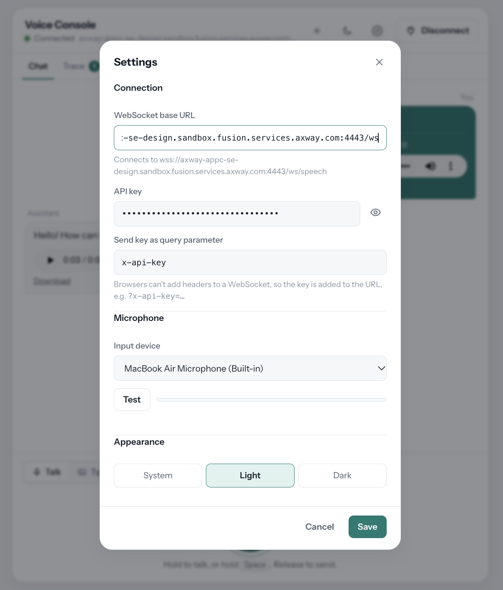
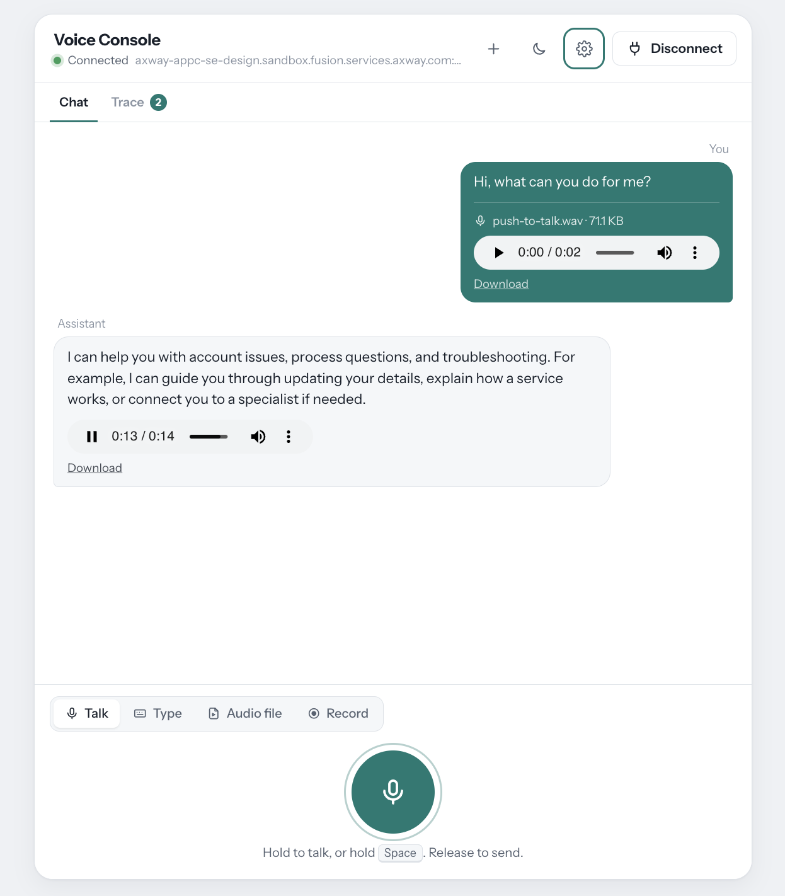

# Amplify Fusion - Websocket Voice Chat Demo Using Mistral AI

An AI voice chatbot demo project created by Axway colleague, [Sebastien MORENO](https://github.com/SebM0), based on my [Fusion AI Chat Conversation Project](https://github.com/lbrenman/fusion-ai-chat-conversation-api) but with a major update to support a Fusion Websocket connection for streaming audio and using Mistral Text to Speech, Speech to Text and AI Chat Fusion connections.

The project was refactored to:
* Add API Key authentication
* Comply with the original Postgres DB conversation table
* Add a Push To Talk feature to the included web app for having natural language conversations with the chatbot

Features include:
* Push-to-talk voice chat with transcribed audio annotation
* Text chat
* Send pre-recorded audio files for chat input
* Record audio file and send for chat input
* API Key security

## Getting Started

* Configure a Postgres DB as described in [Fusion AI Conversation Project](https://github.com/lbrenman/fusion-ai-chat-conversation-api)
* Export the Fusion project zip file in the Fusion Manager Module
* Update the project connectors with your Postgres, Lakera, Gemini (Fallback LLM) and Mistral credentials
* Start the Websocket Server (`WS`) and the Webapp HTTP Server (`Web app`)
* Create a consumer app in Manager and get an API Key
* Copy the Web app URL and launch it (e.g. `https://axway-appc-se-design.sandbox.fusion.services.axway.com:9443/chatbot`)
* Copy the Websocket server url (e.g. `wss://axway-appc-se-design.sandbox.fusion.services.axway.com:4443/ws`) and paste it into the web app settings along with your API Key and click connect. The web app will append `/speech`
  
  

* Use the app for a voice chat with the Mistral LLM
  
  


## Web App - Fusion WSS Contract

Here's the contract the Voice Console Web app and the Fusion Websocker Server follows:

### Connecting

```
wss://<host>/<path>?conversationId=<uuid>&x-api-key=<key>
```

- **`conversationId`**: a random UUID generated by the page. A new one is created when you click **New conversation**.
- **API key**: sent as a query parameter, because browsers can't add headers to a WebSocket. It's only added if a key is set, and the parameter name (default `x-api-key`) can be changed in Settings.

### Client → server

| Input | Frame | Payload |
|---|---|---|
| Typed message | Text | `{"type":"CHAT","message":"<text>"}` |
| Push to talk | Binary | 16 kHz, mono, 16-bit PCM **WAV** |
| Record tab | Binary | Same WAV format as push to talk |
| Audio file | Binary | The file's raw bytes, as-is (MP3, WAV, M4A…) |

Each send starts a new **turn**. Everything the server sends afterwards belongs to that turn until the next send.

### Server → client

**Binary frame:** audio for the reply. It's added under the Assistant's text and auto-played. It's **only shown if the turn was audio**; for typed turns it's ignored.

**Text frame:** can be any of these:

| Shape | Example | What the app does |
|---|---|---|
| Single typed object | `{"type":"RESPONSE","message":"Hi Lior!"}` | Processes the one event |
| Array of typed objects | `[{"type":"RESPONSE",…},{"type":"TRANSCRIBED_REQUEST",…}]` | Processes each event in order (order doesn't matter) |
| JSON object with no `type` | `{"foo":"bar"}` | Shows it as formatted JSON in the Assistant bubble |
| Plain text | `Hello there` | Shows it as the Assistant's reply |

**Event types:**

| `type` | `message` is | Effect |
|---|---|---|
| `RESPONSE` | The reply text | Shown in the Assistant bubble. Multiple `RESPONSE` events in one turn are added to the same bubble, one per line. |
| `TRANSCRIBED_REQUEST` | What the server heard | Shown in quotes at the top of your voice bubble. Ignored for typed turns. If it arrives before the reply, the typing dots keep showing. |
| `ERROR` | An error description | Shows the red error banner ("Server error: …"). |
| Anything else | n/a | Ignored, with a warning in the browser console. |

### Connection close

The close code appears in the error banner and in Trace. Common ones: **1000** is a normal close, **1006** is an abnormal close (often a rejected handshake, e.g. a bad API key), **1009** means the message was too big, and **1011** is a server error.
